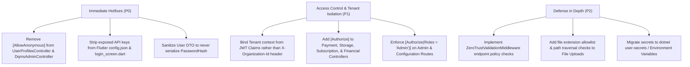

# CSO Security Audit Report: AntiGravity DQMS Enterprise Platform

**Date:** 2026-11-28  
**Audit Standard:** OWASP Top 10:2025 / OWASP API Security Top 10:2023 / ASVS 5.0.0  
**Target Codebase:**  
- **Backend API:** `DNAQMSAPI` (.NET 8 Web API, C#)  
- **Core Library:** `AntiGravity.Enterprise.Shared.Core`  
- **Database Layer:** MySQL 8 Stored Procedures & Schemas (`DNAQMSAPI/DatabaseScripts/`)  
- **Frontend Client:** `dqms_frontend` (Flutter 3.29.0 Web & Multiplatform)  

---

## 1. Executive Summary

A comprehensive source code security assessment was conducted across the entire repository focusing on:
1. **Multi-tenant data isolation & cross-tenant data leaks**
2. **Broken authentication and role checks on administrative endpoints**
3. **SQL, command, and file upload injection vectors**
4. **Exposed secrets, hardcoded API keys, and credential management**

### Vulnerability Matrix

| ID | Title | Severity | Category | Status |
| :--- | :--- | :---: | :--- | :---: |
| **CSO-01** | User Accounts & Password Hashes Disclosed via Anonymous API | **CRITICAL** | A01 / A07 Broken Auth & Access Control | **CONFIRMED** |
| **CSO-02** | Live Organization API Keys Hardcoded in Web Frontend Bundle | **CRITICAL** | A04 Cryptographic Failures / A02 Misconfig | **CONFIRMED** |
| **CSO-03** | Core Admin, Staff, & Reports Controllers Decorated with `[AllowAnonymous]` | **HIGH** | A01 Broken Access Control | **CONFIRMED** |
| **CSO-04** | Client-Controlled Tenant Header (`X-Organization-Id`) Without JWT Validation | **HIGH** | A01 Broken Object Level Auth (BOLA) | **CONFIRMED** |
| **CSO-05** | Cross-Tenant Data Access via Unvalidated Query & Body Parameters | **HIGH** | A01 Multi-Tenant IDOR / BOLA | **CONFIRMED** |
| **CSO-06** | Financial, Payment, and File Storage Endpoints Missing `[Authorize]` | **HIGH** | A01 Missing Function-Level Auth | **CONFIRMED** |
| **CSO-07** | Default JWT Secret Committed in Configuration Files | **HIGH** | A04 Cryptographic Failures | **CONFIRMED** |
| **CSO-08** | Arbitrary File Upload via Unrestricted Extensions in Avatar Upload | **MEDIUM** | A05 Injection & Integrity | **CONFIRMED** |
| **CSO-09** | Potential Path Traversal in Local File Storage Provider | **MEDIUM** | A01 Path Traversal | **CONFIRMED** |
| **CSO-10** | Missing Role-Based Authorization & No-Op Zero Trust Middleware | **MEDIUM** | A01 Broken Role Enforcement | **CONFIRMED** |
| **CSO-11** | Database Passwords Committed in Repository Configuration Files | **MEDIUM** | A02 Security Misconfiguration | **CONFIRMED** |
| **CSO-12** | Command Injection & Direct SQL Injection Audit | **INFORMATIONAL** | A05 Injection | **SAFE (0 Found)** |

---

## 2. In-Depth Security Findings

### CSO-01: User Accounts & Password Hashes Disclosed via Anonymous API (CRITICAL)
- **Vulnerable File:** [UserProfilesController.cs](file:///e:/MySourceCodes/AntiGravity_Projects/WebAPIs/antigravity-enterprise/DNAQMSAPI/DNAQMSAPI.Api/Controllers/UserProfilesController.cs#L38-L75)
- **Vulnerable Code:**
  ```csharp
  [HttpGet]
  [AllowAnonymous]
  public async Task<IActionResult> GetAllUsers()
  {
      var users = await _userService.GetAllUsersAsync();
      return ApiResponse(AntiGravity.Enterprise.Shared.Core.Models.ApiResponse<IEnumerable<User>>.Ok(users));
  }
  ```
- **Live Reproduction:** An unauthenticated `GET http://127.0.0.1:5026/api/v1/users` returns HTTP `200 OK` containing all user records in the database, including the raw `passwordHash` property:
  ```json
  {"id":1,"userCode":"admin","email":"admin@dnaqms.com","passwordHash":"...","isActive":true}
  ```
- **Impact:** Complete exposure of all enterprise user identities and password hashes, allowing offline cracking and credential stuffing. Furthermore, `CreateUser` and `UpdateUser` in the same controller are also marked `[AllowAnonymous]`, allowing unauthenticated attackers to create new accounts or overwrite existing user profiles.
- **Remediation:**
  1. Remove `[AllowAnonymous]` from `GetAllUsers`, `GetUserById`, `CreateUser`, and `UpdateUser`.
  2. Map database entities to a sanitized `UserDto` that excludes `PasswordHash`.
  3. Enforce `[Authorize(Roles = "Admin")]` on user administrative actions.

---

### CSO-02: Live Organization API Keys Hardcoded in Web Frontend Bundle (CRITICAL)
- **Vulnerable Files:**
  - [login_screen.dart](file:///e:/MySourceCodes/AntiGravity_Projects/WebAPIs/antigravity-enterprise/dqms_frontend/lib/features/auth/screens/login_screen.dart#L36-L51)
  - [config.json](file:///e:/MySourceCodes/AntiGravity_Projects/WebAPIs/antigravity-enterprise/dqms_frontend/assets/config.json#L8)
  - Compiled release artifact: `dqms_frontend/build/web/assets/assets/config.json`
- **Vulnerable Code:**
  ```dart
  final List<OrganizationOption> _orgOptions = const [
    OrganizationOption(
      name: 'Downtown Express Clinic',
      apiKey: 'dnaqms_live_icqfweN6llup9Umrp5J3SDR58fA1mGRbxBUDENjiNNw',
      organizationId: 1,
    ),
    OrganizationOption(
      name: 'West Wing Regional Medical Center',
      apiKey: 'dnaqms_live_john_doe_key_445566',
      organizationId: 2,
    ),
    OrganizationOption(
      name: 'Acme Enterprise Corp (Main HQ)',
      apiKey: 'dnaqms_live_alex_mercer_key_998877',
      organizationId: 3,
    ),
  ];
  ```
- **Live Reproduction:** Sending `X-Api-Key: dnaqms_live_icqfweN6llup9Umrp5J3SDR58fA1mGRbxBUDENjiNNw` to `GET http://127.0.0.1:5026/api/v1/organizations` returns HTTP `200 OK` and dumps all organizations in the system.
- **Impact:** Any client visiting the Flutter web application can extract valid live API keys and make authenticated calls as active organization members, bypassing user authentication.
- **Remediation:** Remove production/live API keys from frontend source code and static assets. Organizations should obtain API keys post-login or through authenticated administrative provisioning.

---

### CSO-03: Administrative & Staff Controllers Open via `[AllowAnonymous]` (HIGH)
- **Vulnerable Files:**
  - [DqmsAdminController.cs](file:///e:/MySourceCodes/AntiGravity_Projects/WebAPIs/antigravity-enterprise/DNAQMSAPI/DNAQMSAPI.Api/Controllers/DqmsAdminController.cs#L12): Decorated with `[AllowAnonymous] // Allow anonymous during development/testing`.
  - [DqmsStaffController.cs](file:///e:/MySourceCodes/AntiGravity_Projects/WebAPIs/antigravity-enterprise/DNAQMSAPI/DNAQMSAPI.Api/Controllers/DqmsStaffController.cs#L11): Decorated with `[AllowAnonymous]`.
  - [NavigationMenuController.cs](file:///e:/MySourceCodes/AntiGravity_Projects/WebAPIs/antigravity-enterprise/DNAQMSAPI/DNAQMSAPI.Api/Controllers/NavigationMenuController.cs#L15): Decorated with `[AllowAnonymous] // TODO: lock down with [Authorize]`.
  - [DqmsReportsController.cs](file:///e:/MySourceCodes/AntiGravity_Projects/WebAPIs/antigravity-enterprise/DNAQMSAPI/DNAQMSAPI.Api/Controllers/DqmsReportsController.cs#L13): Decorated with `[AllowAnonymous]`.
- **Impact:** Unauthenticated external actors can:
  - Create and modify physical areas, zones, and process pipelines (`POST /api/v1/admin/area`, `POST /api/v1/admin/process`).
  - Manipulate staff ticket lifecycles (`POST /api/v1/staff/call-next`, `POST /api/v1/staff/complete`) and spoof any operator identity via `X-User-Id` header.
  - Delete or overwrite navigation menu entries (`POST /api/v1/navigation/menu`, `DELETE /api/v1/navigation/menu/{id}`).
  - Export queue audit logs and customer records (`POST /api/v1/dqms/reports/export/csv`).
- **Remediation:** Remove class-level `[AllowAnonymous]` attributes and apply `[Authorize]` with role/policy restrictions across all administrative routes.

---

### CSO-04: Client-Controlled Tenant Header (`X-Organization-Id`) Without JWT Validation (HIGH)
- **Vulnerable File:** [RequestContextMiddleware.cs](file:///e:/MySourceCodes/AntiGravity_Projects/WebAPIs/antigravity-enterprise/DNAQMSAPI/DNAQMSAPI.Security/Middlewares/RequestContextMiddleware.cs#L22-L34)
- **Vulnerable Code:**
  ```csharp
  // Extract from headers
  if (context.Request.Headers.TryGetValue("X-Organization-Id", out var organizationIdSpan))
  {
      if (int.TryParse(organizationIdSpan.ToString(), out int organizationId))
      {
          requestContext.CurrentOrganizationId = organizationId;
      }
  }
  ```
- **Impact:** The request context binds tenant identity directly from an unverified client HTTP header rather than the authenticated caller's cryptographically signed JWT claims. An authenticated user belonging to Tenant 1 can send `X-Organization-Id: 2` to spoof tenant context.
- **Remediation:** Extract tenant identity from `User.FindFirst("OrganizationId")` or validate that the authenticated user is an authorized member of the requested `X-Organization-Id`.

---

### CSO-05: Cross-Tenant Data Access via Query & Body Parameters (HIGH)
- **Vulnerable Endpoints:**
  - `GET /api/v1/dqms/reports/summary?organizationId={id}`
  - `GET /api/v1/dqms/reports/tat-variance?organizationId={id}`
  - `GET /api/v1/admin/areas?organizationId={id}`
  - `GET /api/v1/admin/processes?organizationId={id}`
  - `POST /api/v1/Admin/area` (`{"organizationId": ...}`)
  - `GET /api/v1/storage/search?organizationId={id}`
- **Impact:** Insecure Direct Object References (IDOR). If an attacker knows or enumerates sequential integer IDs (`1, 2, 3`), they can retrieve or overwrite operational metrics, queue data, zones, and stored files across multiple organizations.
- **Remediation:** Enforce server-side tenant filtering: resolve tenant context exclusively from the verified user session, and reject requests where client-supplied `organizationId != requestContext.CurrentOrganizationId`.

---

### CSO-06: Financial, Payment, and Storage Subsystems Missing `[Authorize]` (HIGH)
- **Vulnerable Controllers:**
  - [PaymentController.cs](file:///e:/MySourceCodes/AntiGravity_Projects/WebAPIs/antigravity-enterprise/DNAQMSAPI/DNAQMSAPI.Api/Controllers/PaymentController.cs#L13): Unprotected `/create`, `/upi`, `/upi/qr`.
  - [StorageController.cs](file:///e:/MySourceCodes/AntiGravity_Projects/WebAPIs/antigravity-enterprise/DNAQMSAPI/DNAQMSAPI.Api/Controllers/StorageController.cs#L13): Unprotected `/upload`, `/download/{id}`, `/delete/{id}`, `/search`.
  - [SubscriptionController.cs](file:///e:/MySourceCodes/AntiGravity_Projects/WebAPIs/antigravity-enterprise/DNAQMSAPI/DNAQMSAPI.Api/Controllers/SubscriptionSaaS/SubscriptionController.cs#L12): Unprotected SaaS subscription endpoints.
  - [FinancialReportingController.cs](file:///e:/MySourceCodes/AntiGravity_Projects/WebAPIs/antigravity-enterprise/DNAQMSAPI/DNAQMSAPI.Api/Controllers/FinancialReporting/FinancialReportingController.cs#L11): Unprotected financial ledger endpoints.
- **Impact:** Anonymous actors can initiate payment transactions, generate payment QR codes, upload arbitrary files, search stored customer files, and inspect enterprise billing metrics.
- **Remediation:** Apply `[Authorize]` at the class level for all payment, financial, and storage controllers.

---

### CSO-07: Default JWT Secret Committed in Configuration Files (HIGH)
- **Vulnerable File:** [appsettings.json](file:///e:/MySourceCodes/AntiGravity_Projects/WebAPIs/antigravity-enterprise/DNAQMSAPI/DNAQMSAPI.Api/appsettings.json#L11)
- **Vulnerable Code:**
  ```json
  "JwtSettings": {
    "Secret": "dnaqmsapi-development-secret-key-please-change",
    "Issuer": "DNAQMSAPI",
    "Audience": "DNAQMSAPI-Users",
    "ExpiryMinutes": 480
  }
  ```
- **Impact:** If deployed to production without overriding this key via environment variables or secret vaults, attackers can sign their own JWT tokens with any `userId` or administrative claims.
- **Remediation:** Require a minimum 256-bit secret loaded from secure environment variables or Azure Key Vault / AWS Secrets Manager; fail startup if the placeholder key is detected in non-development environments.

---

### CSO-08: Arbitrary File Upload via Unrestricted Extensions in Avatar Upload (MEDIUM)
- **Vulnerable File:** [UserProfilesController.cs](file:///e:/MySourceCodes/AntiGravity_Projects/WebAPIs/antigravity-enterprise/DNAQMSAPI/DNAQMSAPI.Api/Controllers/UserProfilesController.cs#L100-L140)
- **Vulnerable Code:**
  ```csharp
  extension = Path.GetExtension(file.FileName);
  var uniqueFileName = $"user_{id}_{DateTime.UtcNow.Ticks}{extension}";
  var physicalPath = Path.Combine(uploadDir, uniqueFileName);
  await System.IO.File.WriteAllBytesAsync(physicalPath, fileBytes);
  ```
- **Impact:** The code accepts any file extension without allowlisting image types (`.jpg`, `.jpeg`, `.png`, `.webp`). An attacker can upload `.html`, `.svg` (with XSS script payloads), or executable script extensions.
- **Remediation:** Implement strict extension validation (e.g. `new[] { ".png", ".jpg", ".jpeg", ".webp" }`), validate magic bytes (MIME sniffing), and sanitize file names.

---

### CSO-09: Potential Path Traversal in Local Storage Provider (MEDIUM)
- **Vulnerable File:** [LocalStorageProvider.cs](file:///e:/MySourceCodes/AntiGravity_Projects/WebAPIs/antigravity-enterprise/DNAQMSAPI/DNAQMSAPI.Storage/Providers/LocalStorageProvider.cs#L43-L58)
- **Vulnerable Code:**
  ```csharp
  public Task<Stream?> DownloadAsync(string providerFileId, OrganizationStorageConfig config)
  {
      string fullPath = Path.Combine(_basePath, providerFileId);
      ...
  }
  public Task<bool> DeleteAsync(string providerFileId, OrganizationStorageConfig config)
  {
      string fullPath = Path.Combine(_basePath, providerFileId);
      ...
      File.Delete(fullPath);
  }
  ```
- **Impact:** `Path.Combine` resolves relative segments (`../`). If `providerFileId` contains directory traversal sequences, an attacker could download or delete files outside of `App_Data/Uploads`.
- **Remediation:** Validate that `Path.GetFullPath(fullPath).StartsWith(Path.GetFullPath(_basePath), StringComparison.OrdinalIgnoreCase)`.

---

### CSO-10: Missing Role-Based Authorization & No-Op Zero Trust Middleware (MEDIUM)
- **Vulnerable Files:**
  - [ZeroTrustValidationMiddleware.cs](file:///e:/MySourceCodes/AntiGravity_Projects/WebAPIs/antigravity-enterprise/DNAQMSAPI/DNAQMSAPI.Security/Middlewares/ZeroTrustValidationMiddleware.cs#L22-L33)
  - All Controllers across `DNAQMSAPI.Api`
- **Vulnerable Code:**
  ```csharp
  // Simple generic example: enforce everything needs "api.access"
  // For production, we'd read [Authorize(Policy="some-permission")]
  bool isAuthorized = true; // Replace with actual check based on Endpoint metadata
  ```
- **Impact:** The Zero Trust middleware is a no-op that allows all requests. In addition, 0 controllers check roles (e.g. `[Authorize(Roles = "Admin")]`). An authenticated standard user has the same API privileges as an executive system administrator.
- **Remediation:** Implement endpoint metadata policy inspection in `ZeroTrustValidationMiddleware` and decorate sensitive admin routes with `[Authorize(Roles = "Admin,SuperAdmin")]`.

---

### CSO-11: Database Passwords Committed in Configuration Files (MEDIUM)
- **Vulnerable Files:**
  - [appsettings.json](file:///e:/MySourceCodes/AntiGravity_Projects/WebAPIs/antigravity-enterprise/DNAQMSAPI/DNAQMSAPI.Api/appsettings.json#L20)
  - [appsettings.Development.json](file:///e:/MySourceCodes/AntiGravity_Projects/WebAPIs/antigravity-enterprise/DNAQMSAPI/DNAQMSAPI.Api/appsettings.Development.json#L14-L78)
- **Vulnerable Code:** Hardcoded connection strings with usernames and passwords (`root:mysql`, `sa:YourStrongPassword123!`, `dnaqms:YourOraclePassword123!`).
- **Remediation:** Use .NET Secret Manager (`dotnet user-secrets`) during local development and environment variables (`ConnectionStrings__DefaultConnection`) in staging and production.

---

### CSO-12: SQL and Command Injection Audit (SAFE / 0 FOUND)
- **Command Injection:** 0 usages of `Process.Start`, `cmd.exe`, or shell processes found in the application layer.
- **SQL Injection:**
  - All standard database operations route through Dapper stored procedure calls (`CommandType.StoredProcedure`) with typed parameters, cleanly separating code from data.
  - Stored procedures in `DatabaseScripts/` avoid dynamic `PREPARE stmt FROM` with user input (only static DDL migration checks are present).
  - [LogsController.cs](file:///e:/MySourceCodes/AntiGravity_Projects/WebAPIs/antigravity-enterprise/DNAQMSAPI/DNAQMSAPI.Api/Controllers/LogsController.cs#L110) dynamically builds a SQL query but correctly parameterizes all user inputs via `DynamicParameters`.

---

## 3. Recommended Remediation Roadmap



---

## 4. Audit Evidence Artifacts
- **Audit Report:** [.gstack/cso-reports/cso-audit-security-report-2026-11-28.md](file:///e:/MySourceCodes/AntiGravity_Projects/WebAPIs/antigravity-enterprise/.gstack/cso-reports/cso-audit-security-report-2026-11-28.md)
- **User Disclosure Endpoint Verified:** `GET /api/v1/users`
- **Exposed Key Verified:** `X-Api-Key: dnaqms_live_icqfweN6llup9Umrp5J3SDR58fA1mGRbxBUDENjiNNw`
