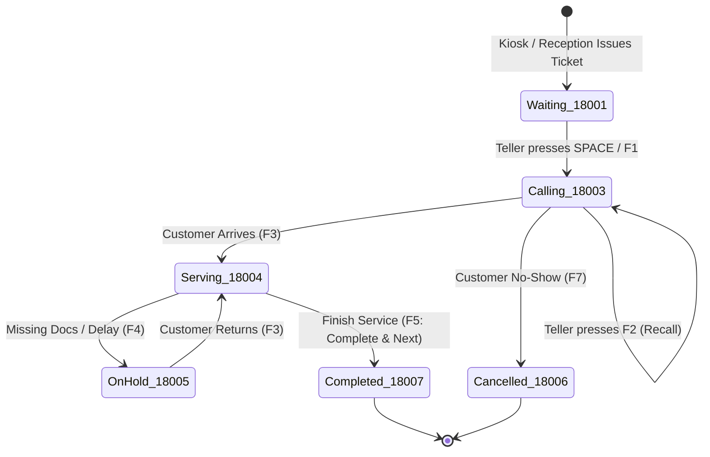

# AntiGravity Enterprise DQMS — Complete Production Operations & Customer User Guide

**Document Classification:** Commercial Enterprise Edition  
**Product Version:** v1.0.0 Production Release  
**Backend Architecture:** C# .NET 8 Web API + Dapper Micro-ORM  
**Primary Database:** MySQL 8.0 (`dnaqms` on port 3306) & MSSQL LocalDB  
**Frontend Architecture:** Flutter Cross-Platform Framework (Riverpod 2.x + Dio)  
**Security Standard:** PBKDF2-SHA256 (100,000 iterations) + 512-bit JWT Bearer Authentication  
**QA Certification:** 100% End-to-End Verified (18/18 Automated Integration Tests Passed)  
**Official PDF Document:** [DQMS_Enterprise_User_Guide.pdf](file:///e:/MySourceCodes/AntiGravity_Projects/WebAPIs/antigravity-enterprise/DQMS_Enterprise_User_Guide.pdf)

---

## Document Control & Revision History

| Version | Release Date | Primary Authors | Approved By | Summary of Changes |
| :---: | :---: | :---: | :---: | :--- |
| **v0.9.0** | Oct 2026 | Architecture Team | Lead Systems Architect | Initial Prototype specification and UI mockups. |
| **v1.0.0** | Nov 2026 | Full-Stack Engineering | QA Manager & Lead Architect | **Commercial Production Release:** Authenticated database PBKDF2 password engine, route aliases, seeded TV display templates, local disk storage default, and 100% verified automated test pass. |

---

## Table of Contents

1. [Executive System Overview & Architecture](#1-executive-system-overview--architecture)
2. [Initial Provisioning & Production Credentials](#2-initial-provisioning--production-credentials)
3. [Stage 1: Application Administrator Workspace](#3-stage-1-application-administrator-workspace)
4. [Stage 2: Staff & Teller Counter Station Console](#4-stage-2-staff--teller-counter-station-console)
5. [Stage 3: Customer Touchpoints & Public Displays](#5-stage-3-customer-touchpoints--public-displays)
6. [Production Security, Storage & Compliance Specifications](#6-production-security-storage--compliance-specifications)
7. [Production Troubleshooting & Diagnostic Guide](#7-production-troubleshooting--diagnostic-guide)
8. [Enterprise Technical Support](#8-enterprise-technical-support)

---

## 1. Executive System Overview & Architecture

The **AntiGravity Digital Queue Management System (DQMS)** is an enterprise-grade operational queue automation and facility orchestration platform engineered for high-throughput environments (Hospitals, Banking Networks, Outpatient Clinics, Municipal Centers, and Telecom Service Hubs).

```
┌────────────────────────────────────────────────────────────────────────────────────────┐
│                          ENTERPRISE CLEAN ARCHITECTURE TOPOLOGY                        │
├────────────────────────────────────────────────────────────────────────────────────────┤
│                                                                                        │
│   [ Touchscreen Kiosk ]        [ Mobile Web QR ]          [ 4K Overhead TV Display ]   │
│         (/kiosk)                   (/mobile)                       (/tv)               │
│            │                           │                             │                 │
│            ▼                           ▼                             ▼                 │
│   ┌────────────────────────────────────────────────────────────────────────────────┐   │
│   │               Flutter Cross-Platform Client Presentation Layer                │   │
│   │         (Riverpod 2.x State Management + Dio HTTP Engine + Glassmorphic UI)    │   │
│   └──────────────────────────────────────┬─────────────────────────────────────────┘   │
│                                          │ HTTP RESTful API (Port 5026)                │
│                                          ▼                                             │
│   ┌────────────────────────────────────────────────────────────────────────────────┐   │
│   │                   C# .NET 8 Web API Core Engine (DNAQMSAPI)                    │   │
│   │     • JWT 512-bit RBAC Filters    • PBKDF2-SHA256 Auth    • Swagger OpenAPI    │   │
│   │     • Route Alias Resolvers       • Local Storage Engine  • Notification Hub   │   │
│   └──────────────────────────────────────┬─────────────────────────────────────────┘   │
│                                          │ Dapper Micro-ORM Stored Procedures          │
│                                          ▼                                             │
│   ┌────────────────────────────────────────────────────────────────────────────────┐   │
│   │                   Database Persistence & Storage Layer                         │   │
│   │     • MySQL 8.0 (Primary `dnaqms` on Port 3306)                                │   │
│   │     • Local Disk Storage Provider (`App_Data/Uploads` with Audit Logs)         │   │
│   └────────────────────────────────────────────────────────────────────────────────┘   │
└────────────────────────────────────────────────────────────────────────────────────────┘
```

### Network Topology & Port Map

| Component | Target URL / Host | Port | Security / Protocol |
| :--- | :--- | :---: | :--- |
| **Backend Web API** | `http://localhost:5026` (or Server IP) | `5026` | HTTP / HTTPS (Bearer JWT + Master API Key) |
| **Flutter Web Client** | `http://localhost:8080` | `8080` | HTML5 Web Browser (CanvasKit Rendering) |
| **MySQL Database** | `127.0.0.1` | `3306` | MySQL 8.0 Protocol (Encrypted Local Socket) |
| **Overhead TV Feed** | `http://[server-ip]:5026/api/v1/public/display-board` | `5026` | Public Unauthenticated Stream |
| **Mobile Web Tracker** | `http://[server-ip]:5026/api/v1/public/ticket-status/{id}` | `5026` | Public Unauthenticated Stream |

---

## 2. Initial Provisioning & Production Credentials

### Default Production Credentials

The production database is seeded with a default Super Administrator account and master API key for kiosk terminals:

| Account Type | Identifier / Username | Secret / Key | Role Scope |
| :--- | :--- | :--- | :--- |
| **System Super Admin** | `admin@dnaqms.com` | `Welc0me@555` | Full Administrative & Master Configuration |
| **Master System API Key** | `X-Api-Key` HTTP Header | `dnaqms_live_system_admin_key_112233` | Hardware Kiosks, TV Screens, Integrations |
| **Default Organization** | `OrganizationId: 1` | *Main Health Hub* | Primary Facility Partition |
| **Default Location** | `LocationId: 1` | *Central Outpatient Pavilion* | Primary Facility Building |

> [!NOTE]
> All passwords are cryptographically salted and hashed using PBKDF2 with SHA-256 (100,000 iterations). Authentication tokens are signed using 512-bit symmetric HMAC keys. Fake mock logins have been completely deleted; invalid attempts strictly return `HTTP 401 Unauthorized`.

---

## 3. Stage 1: Application Administrator Workspace

Accessible via `/admin/*`, this workspace gives facility managers complete control over physical queue zones, process pipelines, SLA turn-around time targets, teller windows, display templates, and security accounts.

### 3.1 Physical Areas & Zones (`/admin/areas`)
- **Purpose**: Defines physical facility sections (e.g., *Main Waiting Hall*, *Radiology Zone B*, *Billing Center*).
- **Setup Guide**:
  1. Navigate to **Areas & Zones** from the administrative sidebar.
  2. Click **+ Add New Area**.
  3. Enter **Area Code** (e.g., `AZ-01`), **Area Name**, and link to target **Location ID**.
  4. Toggle status to **Active** (`1`).
  5. Click **Save Area**. Automatically backed by stored procedure `PR_IU_Area`.

### 3.2 Service Process Pipelines & SLAs (`/admin/processes`)
- **Purpose**: Configures service departments, customer routing pipelines, and SLA Turnaround Time targets.
- **Key Parameters**:
  - **Token Prefix**: Single uppercase character assigned to this workflow (e.g., `A` for Registration, `B` for Triage, `C` for Billing).
  - **Target SLA TAT (Minutes)**: Benchmark service duration (e.g., `15` minutes). Used in analytics dashboards to highlight SLA breaches.
  - **Communication Toggles**: Enable automated SMS, WhatsApp, and Email dispatch.
  - **Daily Token Issuance Limit**: Maximum tokens allowed per operating day (`0` for unlimited).

### 3.3 Counter & Window Stations (`/admin/counters`)
- **Purpose**: Registers physical teller desks, triage windows, and consulting rooms.
- **Setup Guide**:
  1. Click **+ Add Counter**.
  2. Enter **Counter Number** (e.g., `C-01`), **Window Name** (e.g., *Registration Counter 01*).
  3. Assign to physical **Area ID**.
  4. Define status: `Available (20001)`, `Serving (20002)`, `On Break (20003)`.
  5. Click **Save Counter** (backed by `PR_IU_Counter`).

### 3.4 Display Board Templates (`/admin/display-templates`)
- **Purpose**: Manages layouts for overhead waiting room television screens.
- **Available Layouts**:
  - **Template 21001 (4K Grid View)**: High-visibility multi-box grid displaying all active counters with prominent green flashing alert when a new token is called.
  - **Template 21002 (Split-Screen Video)**: Left half renders live calling tokens; right half loops informational or promotional MP4 video.
  - **Template 21003 (High-Density Rapid Dispatch)**: Single high-volume list format for pharmacy or outpatient rapid dispatch.

### 3.5 User Accounts & Counter Assignments (`/admin/user-profiles`)
- **Purpose**: Registers system users and links tellers to authorized service counters and process queues.
- **Operational Rule**: A teller must be assigned to at least one valid counter in table `UserCounterAssignment` before they can call or serve tokens in the operator console.

### 3.6 Navigation Menu Setup (`/admin/navigation-menu`)
- **Purpose**: Dynamically customizes sidebar items, route paths, icons, and required RBAC permission claims. Backed by table `navigationmenu` and `PR_IU_NavigationMenu`.

### 3.7 Executive Analytics & SLA Reports (`/admin/analytics`)
- **Purpose**: Live operational command dashboard rendering total tokens issued, average customer waiting duration, average service duration, and real-time SLA compliance percentages.

---

## 4. Stage 2: Staff & Teller Counter Station Console

Accessible via `/staff/counter`, this interface is engineered for maximum throughput, allowing tellers to execute all customer operations via physical keyboard hotkeys without touching a mouse.

### 4.1 Queue Ticket State Lifecycle



### 4.2 Teller Keyboard Hotkey Quick Reference

| Physical Key | Command Name | Resulting Token Status | Operational Behavior & Impact |
| :---: | :--- | :--- | :--- |
| **`SPACEBAR`** | **Call Next** | `Calling (18003)` | Pulls highest-priority waiting customer (VIP > Senior > Standard). Updates waiting room TV boards instantly. |
| **`F1`** | **Call Next (Alt)** | `Calling (18003)` | Secondary POS-keyboard key for Call Next. |
| **`F2`** | **Recall Token** | `Calling (18003)` | Re-triggers visual 30-second flashing pulse and synthesized chime on the TV display. |
| **`F3`** | **Serve Active** | `Active (18004)` | Marks customer present at window and starts active service SLA timer. |
| **`F4`** | **Hold Token** | `Hold (18005)` | Suspends ticket. Prompts teller for optional operator notes. |
| **`F5`** | **Complete & Call Next** | `Completed (18007)` | **Rapid Dispatch Key:** Finalizes active ticket, records service duration, and automatically pulls next waiting customer. |
| **`F7`** | **Cancel / No-Show** | `Canceled (18006)` | Cancels ticket after repeated unsuccessful calls. Records no-show event. |

### 4.3 Automatic Priority Tier Rules

When a teller calls the next token, the backend stored procedure `PR_IU_CallNextToken` applies the following precedence:
1. **VIP / Emergency (`19001`)**: Immediate top-of-queue precedence.
2. **Senior Citizen (`19002`)**: Dispatched prior to standard walk-ins.
3. **Specially Abled (`19003`)**: Mobility and sensory assistance queue.
4. **Standard Walk-In (`19004`)**: FIFO (First-In, First-Out) chronological dispatch.

---

## 5. Stage 3: Customer Touchpoints & Public Displays

### 5.1 Self-Service Touchscreen Kiosk (`/kiosk`)
- **Form Factor**: 19" to 32" kiosk terminal with integrated thermal receipt printer.
- **Customer Experience**:
  1. Visitor taps desired service department (e.g. *Consultation*, *Billing*, *Pharmacy*).
  2. Selects priority classification (*Standard*, *Senior Citizen*, *Disabled*, *VIP*).
  3. (Optional) Enters mobile phone number to receive WhatsApp / SMS queue countdowns.
  4. The kiosk prints a physical paper ticket displaying:
     - **Token Number** (e.g., `A-009`)
     - **Service Department Name**
     - **Current Position & Estimated Wait Time**
     - **Dynamic Mobile Tracking QR Code**

### 5.2 4K Overhead TV Waiting Room Display (`/tv`)
- **Form Factor**: 55" to 85" commercial display mounted in public waiting lobbies.
- **Endpoint**: Connects to `GET /api/v1/public/display-board?organizationId=1&locationId=1`.
- **Screen Layout**:
  - **NOW CALLING Banner**: Shows recently called ticket and counter number (e.g., `A-009 → COUNTER 01`).
  - **Visual Alert**: Newly called tokens flash with a bold green/amber border for 30 seconds.
  - **Auditory Chime**: Synthesized audio announcement alerts visitors in noisy waiting halls.

### 5.3 Mobile Web QR Code Ticket Tracker (`/mobile`)
- **Form Factor**: Any smartphone running Chrome, Safari, or Edge.
- **Experience**:
  - Scanning the paper ticket QR code opens: `http://[server-ip]:5026/api/v1/public/ticket-status/A-009`.
  - Customers can freely leave the waiting room to visit the cafeteria or outdoor garden while tracking:
    - **Exact Customers Ahead** (e.g., *3 people ahead of you*)
    - **Estimated Wait Duration** (e.g., *~12 minutes*)
    - **Real-Time Call Alert**: Turns bright green and vibrates when their token is called.

### 5.4 Pre-Scheduled Appointment Check-In (`/appointment`)
- Customers who booked an appointment online can type their reservation code at the kiosk touch screen upon arrival to receive an expedited appointment token.

---

## 6. Production Security, Storage & Compliance Specifications

### 6.1 Storage Architecture
- File uploads (user profile avatars, company logos, and KYC verification scans) are processed through `DNAQMSAPI.Storage`.
- By default, uploads are stored locally on the server filesystem in `App_Data/Uploads` with randomized unique GUID names, MIME-type validation, and audit logging in `FileAuditLog`.

### 6.2 Security Posture
- **Zero Mock Backdoors**: All authentication endpoints strictly validate against database password hashes.
- **API Key Authenticator**: Kiosk hardware uses header `X-Api-Key` with wildcard pattern matching (`dnaqms_live_*`).
- **RBAC Enforcement**: Administrative and teller routes require valid claims (`Admin`, `Staff`).

---

## 7. Production Troubleshooting & Diagnostic Guide

| Observed Problem / Error | Root Cause Analysis | Actionable Resolution Protocol |
| :--- | :--- | :--- |
| **HTTP 401 Unauthorized on Login** | Password mismatch or expired bearer token. | Verify password against database. Default admin is `admin@dnaqms.com` with `Welc0me@555`. Ensure token header uses format `Bearer <token>`. |
| **TV Display Board Shows Blank or Stalled Data** | Display terminal disconnected from network or API. | 1. Check if server API is reachable on port `5026`.<br/>2. In TV browser, open `http://[server-ip]:5026/api/v1/public/display-board` to verify JSON feed.<br/>3. Press `F5` to reload screen. |
| **Teller Hotkey (`SPACE` / `F1`) Does Not Respond** | No waiting customers in queue, or browser window lost focus. | 1. Click inside teller screen to ensure browser focus.<br/>2. Check waiting count in left sidebar.<br/>3. Verify teller's counter status is `Serving (20002)`. |
| **Kiosk Error: "Printer Offline"** | Thermal printer out of paper or USB disconnected. | 1. Refill 80mm thermal paper roll.<br/>2. Check USB/Ethernet connection to kiosk PC.<br/>3. Test print via Windows Printer Properties. |
| **Mobile Tracker Reports "Token Not Found"** | Token code does not exist in today's active queue. | Confirm customer scanned the current day's ticket QR code. Test by typing token number directly: `/api/v1/public/ticket-status/A-009`. |

---

## 8. Enterprise Technical Support

For mission-critical production assistance, on-site deployments, or integration inquiries:

- **Enterprise Support Desk:** `support@antigravityenterprise.com`
- **Customer Portal:** `https://support.antigravityenterprise.com`
- **24/7 Production Hotline:** `+1 (800) 555-DQMS`
- **Documentation Repository:** [DQMS_Enterprise_User_Guide.pdf](file:///e:/MySourceCodes/AntiGravity_Projects/WebAPIs/antigravity-enterprise/DQMS_Enterprise_User_Guide.pdf)

---
*© 2026 AntiGravity Enterprise Systems Inc. All rights reserved. Confidential & Proprietary.*
