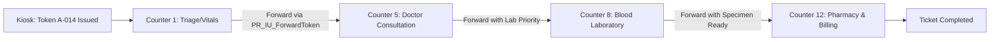

# AntiGravity Enterprise DQMS — Complete Production Operations & Customer User Guide

**Document Classification:** Commercial Enterprise Edition  
**Product Version:** v1.2.0 Production Release (with Multi-Region Data Residency, GDPR & Enterprise Resiliency)  
**Backend Architecture:** C# .NET 8 Web API + Dapper Micro-ORM  
**Primary Database:** MySQL 8.0 (`dnaqms` on port 3306) & MSSQL LocalDB  
**Edge Database:** SQLite Embedded Local Replicas (`edge_dqms.db`)  
**Frontend Architecture:** Flutter Cross-Platform Framework (Riverpod 2.x + Dio HTTP Engine)  
**Security Standard:** PBKDF2-SHA256 (100,000 iterations), 512-bit JWT Bearer Authentication, AES-256-GCM Envelope Encryption, HMAC-SHA256 Blind Indexing  
**Compliance Coverage:** GDPR (EU), NESA (UAE), PDPL (Saudi Arabia), HIPAA (US), DPDP (India)  
**QA Certification:** 100% End-to-End Verified (8/8 .NET Unit Tests & 83/83 Flutter Integration Tests Passed)  
**Official PDF Document:** [DQMS_Enterprise_User_Guide.pdf](file:///e:/MySourceCodes/AntiGravity_Projects/WebAPIs/antigravity-enterprise/DQMS_Enterprise_User_Guide.pdf)

---

## Document Control & Revision History

| Version | Release Date | Primary Authors | Approved By | Summary of Changes |
| :---: | :---: | :---: | :---: | :--- |
| **v0.9.0** | Oct 2026 | Architecture Team | Lead Systems Architect | Initial Prototype specification and UI mockups. |
| **v1.0.0** | Nov 2026 | Full-Stack Engineering | QA Manager & Lead Architect | **Commercial Production Release:** Authenticated PBKDF2 password engine, route aliases, seeded TV display templates, local disk storage default, and 100% verified automated test pass. |
| **v1.1.0** | Nov 2026 | Enterprise Systems Team | Chief Information Officer | **Enterprise Resiliency & Operations Edition:** Added end-to-end "How to Use" operational guides for N-Level Multi-Department Workflows, Webhook Notification Engine with HMAC-SHA256 signatures, Offline Edge Resilience with 3-state banners, and Digital Signage Campaigns with PIN-secured Emergency Broadcast Overrides. |
| **v1.2.0** | Nov 2026 | Enterprise Security & Data Privacy Team | Chief Information Security Officer | **Data Sovereignty, Multi-Region Residency & GDPR Compliance Edition:** Added Section 3.9 operational guide for geographic data residency sharding, AES-256-GCM envelope encryption, HMAC-SHA256 blind indexing, zero-trust fail-closed routing, GDPR Article 17 Right-To-Be-Forgotten cryptographic shredding, Article 20 data portability JSON export, and automated 12-hour retention purge daemon. Added Section 4.6 for `/admin/data-residency` admin view and updated API reference. |

---

## Table of Contents

1. [Executive System Overview & Architecture](#1-executive-system-overview--architecture)
2. [Production Credentials & Role-Based Access](#2-production-credentials--role-based-access)
3. [End-to-End Operational Guide ("How to Use It")](#3-end-to-end-operational-guide-how-to-use-it)
   - 3.1 [Walk-In Visitor & Patient Touchpoints](#31-walk-in-visitor--patient-touchpoints)
   - 3.2 [Staff & Counter Teller Console](#32-staff--counter-teller-console)
   - 3.3 [N-Level Multi-Department Workflow Forwarding](#33-n-level-multi-department-workflow-forwarding)
   - 3.4 [4K Waiting Room TV & Digital Signage Media Zone](#34-4k-waiting-room-tv--digital-signage-media-zone)
   - 3.5 [Safety & Security: Emergency Broadcast Console](#35-safety--security-emergency-broadcast-console)
   - 3.6 [Facility Shift Supervisor: TAT Variance & Bottleneck Heatmaps](#36-facility-shift-supervisor-tat-variance--bottleneck-heatmaps)
   - 3.7 [IT Systems Administrator: Webhook Notification Engine](#37-it-systems-administrator-webhook-notification-engine)
   - 3.8 [IT Systems Administrator: Offline Edge Resilience & Hybrid Sync](#38-it-systems-administrator-offline-edge-resilience--hybrid-sync)
   - 3.9 [Data Protection Officer & IT Administrator: Multi-Region Data Residency & GDPR Privacy Engine](#39-data-protection-officer--it-administrator-multi-region-data-residency--gdpr-privacy-engine)
4. [Administrative Facility Workspaces](#4-administrative-facility-workspaces)
   - 4.1 [Physical Areas & Zones (/admin/areas)](#41-physical-areas--zones-adminareas)
   - 4.2 [Service Process Pipelines & SLAs (/admin/processes)](#42-service-process-pipelines--slas-adminprocesses)
   - 4.3 [Counter & Window Stations (/admin/counters)](#43-counter--window-stations-admincounters)
   - 4.4 [Digital Signage Campaigns (/admin/signage)](#44-digital-signage-campaigns-adminsignage)
   - 4.5 [Navigation Menu Permissions (/admin/navigation-menu)](#45-navigation-menu-permissions-adminnavigation-menu)
   - 4.6 [Multi-Region Data Residency & GDPR Console (/admin/data-residency)](#46-multi-region-data-residency--gdpr-console-admindata-residency)
5. [Production API Endpoints & Stored Procedures](#5-production-api-endpoints--stored-procedures)
6. [Security, Storage & Compliance Specifications](#6-security-storage--compliance-specifications)
7. [Production Troubleshooting & Diagnostic Guide](#7-production-troubleshooting--diagnostic-guide)
8. [Enterprise Technical Support](#8-enterprise-technical-support)

---

## 1. Executive System Overview & Architecture

The **AntiGravity Digital Queue Management System (DQMS)** is an enterprise-grade operational queue automation and facility orchestration platform engineered for high-throughput environments (Hospitals, Banking Networks, Outpatient Clinics, Municipal Centers, and Telecom Service Hubs).

```
┌────────────────────────────────────────────────────────────────────────────────────────┐
│                          ENTERPRISE CLEAN ARCHITECTURE TOPOLOGY                        │
├────────────────────────────────────────────────────────────────────────────────────────┤
│                                                                                        │
│   [ Touchscreen Kiosk ]        [ Mobile Web QR ]          [ 4K Overhead TV Display ]   │
│         (/kiosk)                   (/mobile)                       (/tv)               │
│            │                           │                             │                 │
│            ▼                           ▼                             ▼                 │
│   ┌────────────────────────────────────────────────────────────────────────────────┐   │
│   │               Flutter Cross-Platform Client Presentation Layer                │   │
│   │     • Riverpod 2.x State Management  • Offline Edge State Sync Banner          │   │
│   │     • Emergency Broadcast Overlay    • Audio-Ducked Media Zone Player          │   │
│   └──────────────────────────────────────┬─────────────────────────────────────────┘   │
│                                          │ HTTP RESTful API (Port 5026)                │
│                                          ▼                                             │
│   ┌────────────────────────────────────────────────────────────────────────────────┐   │
│   │                   C# .NET 8 Web API Core Engine (DNAQMSAPI)                    │   │
│   │     • 512-bit JWT RBAC Engine     • PBKDF2-SHA256 Auth    • Swagger OpenAPI    │   │
│   │     • Webhook Dispatcher (HMAC)   • Signage & Broadcast   • Hybrid Edge Sync   │   │
│   └──────────────────────────────────────┬─────────────────────────────────────────┘   │
│                                          │ Dapper Micro-ORM Stored Procedures          │
│                                          ▼                                             │
│   ┌────────────────────────────────────────────────────────────────────────────────┐   │
│   │                   Database Persistence & Storage Layer                         │   │
│   │     • MySQL 8.0 (Primary `dnaqms` on Port 3306) & MSSQL LocalDB                │   │
│   │     • SQLite Edge Replicas (`edge_dqms.db`) for Offline Autonomous Survivability│   │
│   │     • Local Disk Storage Provider (`App_Data/Uploads` with FileAuditLog)       │   │
│   └────────────────────────────────────────────────────────────────────────────────┘   │
└────────────────────────────────────────────────────────────────────────────────────────┘
```

### Network Topology & Port Map

| Component | Target URL / Host | Port | Security / Protocol |
| :--- | :--- | :---: | :--- |
| **Backend Web API** | `http://localhost:5026` (or Server IP) | `5026` | HTTP / HTTPS (Bearer JWT + Master API Key) |
| **Flutter Web Client** | `http://localhost:8080` | `8080` | HTML5 Web Browser (CanvasKit Rendering) |
| **MySQL Database** | `127.0.0.1` | `3306` | MySQL 8.0 Protocol (Encrypted Local Socket) |
| **Overhead TV Feed** | `http://[server-ip]:5026/api/v1/public/display-board` | `5026` | Public Unauthenticated Stream |
| **Mobile Web Tracker** | `http://[server-ip]:5026/api/v1/public/ticket-status/{id}` | `5026` | Public Unauthenticated Stream |
| **Edge Node Sync Agent** | `http://[edge-ip]:5028/api/v1/edge/sync` | `5028` | Local Network Encrypted Sync Channel |

---

## 2. Production Credentials & Role-Based Access

The production database is seeded with pre-configured administrative accounts and integration keys:

| Account Type | Identifier / Username | Secret / Key | Role Scope & Responsibilities |
| :--- | :--- | :--- | :--- |
| **System Super Admin** | `admin@dnaqms.com` | `Welc0me@555` | Full administrative control, facility configuration, security, edge sync, and webhooks. |
| **Shift Supervisor** | `supervisor@dnaqms.com` | `Welc0me@555` | Real-time queue supervision, teller reallocations, TAT variance heatmaps, emergency broadcast authorization. |
| **Counter Teller** | `teller1@dnaqms.com` | `Welc0me@555` | Operational counter station, calling tokens, serving, holding, forwarding, and completing. |
| **Safety / Security Officer** | `security@dnaqms.com` | `Welc0me@555` | Incident command, emergency broadcast triggering with supervisor PIN (`9999` or `1234`). |
| **Master System API Key** | `X-Api-Key` HTTP Header | `dnaqms_live_system_admin_key_112233` | Hardware Kiosks, TV Screens, automated webhook listeners, IoT chime boxes. |

---

## 3. End-to-End Operational Guide ("How to Use It")

This section provides operational, click-by-click and keystroke-by-keystroke procedures for every facility role.

---

### 3.1 Walk-In Visitor & Patient Touchpoints

#### A. Self-Service Touchscreen Kiosk (`/kiosk`)
The self-service kiosk allows patients and visitors to self-register in under 10 seconds:

1. **Select Service Department**:
   - The visitor approaches the kiosk display.
   - Large, high-contrast touch tiles display active services (e.g., *Outpatient Consultation*, *Blood Collection / Laboratory*, *Radiology / Imaging*, *Pharmacy & Cashier*).
   - Tap the desired department tile.
2. **Choose Priority Demographic**:
   - **Standard Queue**: For general walk-in visits.
   - **Senior Citizen (65+)**: Automatically applies priority boost.
   - **Specially Abled / Mobility Impaired**: Directs visitor to accessible ground-floor counters.
   - **VIP / Medical Emergency**: Flags ticket for immediate next-call queue placement.
3. **Optional Mobile Tracking Registration**:
   - Touchscreen prompts: *"Enter your mobile number for live SMS / WhatsApp updates"*.
   - Visitor enters their 10-digit phone number using the on-screen numeric keypad and taps **Confirm**.
4. **Ticket Printing & Mobile QR Capture**:
   - The integrated thermal printer issues a paper ticket with:
     - Prominent alphanumeric code (e.g., `A-014`).
     - Service department name and assigned facility area.
     - Number of visitors ahead (e.g., *Waiting: 3 ahead*).
     - Approximate wait time (e.g., *Estimated: ~12 minutes*).
     - **Dynamic Mobile QR Code**.

#### B. Pre-Scheduled Appointment Check-In (`/appointment`)
1. Visitors who previously booked an appointment online tap **"Check-In Appointment"** at the kiosk bottom banner.
2. Enter the 6-character booking reference code or scan their appointment confirmation barcode.
3. The system matches the slot in `appointment` table, verifies arrival within the ±30 min check-in window, and prints an expedited appointment token that automatically slots into the teller's priority queue.

#### C. Mobile Web Ticket Tracking (`/mobile`)
1. The visitor scans the QR code printed on their paper ticket with any smartphone camera (iOS or Android; no app install required).
2. The browser navigates directly to `http://[server-ip]:5026/api/v1/public/ticket-status/A-014`.
3. The mobile tracker displays:
   - **Live Queue Counter**: Counts down in real-time as preceding customers are served.
   - **Estimated Call Window**: Continuously recalculated from the active department's rolling SLA TAT.
   - **Freedom of Movement**: Patients can wait in the cafeteria, outdoor gardens, or car park without fear of missing their turn.
4. **Immediate Call Alert**: When the teller calls `A-014`, the mobile screen pulses emerald green, vibrates the phone, and sounds an audible ring: *"Now Serving A-014 at Counter 03"*.

---

### 3.2 Staff & Counter Teller Console

Accessible via `/staff/counter`, this interface enables rapid customer processing via physical POS hotkeys without requiring a mouse.

#### Operational Keystroke Reference Table

| Keystroke | Function | Resulting Token Status | Operational Behavior & Facility Impact |
| :---: | :--- | :--- | :--- |
| **`SPACEBAR`** | **Call Next** | `Calling (18003)` | Automatically fetches the highest-priority waiting customer (VIP > Senior > Special Needs > Standard FIFO). Instantly flashes waiting room TV boards and plays chime. |
| **`F1`** | **Call Next (Alt)** | `Calling (18003)` | Alternative POS-keyboard key for Call Next. |
| **`F2`** | **Recall Customer** | `Calling (18003)` | Re-triggers the audio chime and 30-second flashing pulse on the overhead TV display for absent or distracted visitors. |
| **`F3`** | **Serve Active** | `Active (18004)` | Customer has arrived at the counter window. Starts the active service stopwatch to track SLA turnaround time. |
| **`F4`** | **Put on Hold** | `Hold (18005)` | Temporarily suspends the ticket (e.g., waiting for blood lab results, payment authorization, or missing ID). Prompts teller for optional hold notes. |
| **`F5`** | **Complete & Call Next** | `Completed (18007)` | **Rapid Dispatch Key:** Finalizes active ticket, records service duration in audit log, and immediately calls the next waiting visitor in one seamless keystroke. |
| **`F7`** | **Cancel / No-Show** | `Canceled (18006)` | Cancels the ticket after 3 unanswered calls. Marks record as no-show for supervisor reporting. |

#### Detailed Teller Workflow
1. **Log In & Counter Claim**:
   - Teller logs in at `/staff/counter` using their corporate credentials (`teller1@dnaqms.com`).
   - The station automatically binds the teller to their assigned physical counter (e.g., *Counter 02 — Registration*).
2. **Calling the First Customer**:
   - Press **`SPACEBAR`**.
   - The system retrieves the next token from `PR_IU_CallNextToken`.
   - The teller console displays the customer's token (`A-014`), priority tier, and elapsed wait duration.
3. **Serving the Customer**:
   - When the visitor walks up to Counter 02, press **`F3`** (or click **Serve**).
   - The active service stopwatch begins ticking (e.g., `00:03:45`).
   - If the duration exceeds the service department's target SLA (e.g., 15 minutes), the timer badge shifts from blue to amber to alert the teller.
4. **Completing the Service**:
   - When the customer's consultation or transaction is finished, press **`F5`** (**Complete & Call Next**).
   - The active customer is marked `Completed (18007)` with exact service duration saved.
   - The system immediately calls the subsequent waiting customer to eliminate counter idle time.

---

### 3.3 N-Level Multi-Department Workflow Forwarding

In complex facilities, a visitor frequently requires sequential service across multiple departments (e.g., **Registration → Triage → Doctor Consultation → Blood Lab → Billing & Pharmacy**). 

The AntiGravity DQMS enables seamless token handoffs without forcing the patient to return to the kiosk for new tickets:



#### Step-by-Step Forwarding Procedure:
1. While serving an active token at the counter, click the **"Forward Ticket"** button (or press `Ctrl + F`).
2. A modal dialog appears displaying:
   - **Target Process / Department**: Select destination department (e.g., *Pathology / Blood Lab*).
   - **Specific Target Counter (Optional)**: Route to a specific desk or allow any available counter in the target department to pull the ticket.
   - **Priority Maintenance**: Choose whether to retain current priority (`Senior Citizen`), escalate to `VIP`, or adopt standard priority.
   - **Handoff Clinical / Transaction Notes**: Type relevant operational notes (e.g., *"Patient fasted 12 hours; draw lipid panel and blood glucose immediately"*).
3. Click **"Execute Forward"**.
4. **Backend Stored Procedure `PR_IU_ForwardToken` Execution**:
   - Finalizes the current stage at Counter 01.
   - Appends an audit trail entry in `TokenWorkflowHistory` recording transferring teller, receiving department, and timestamp.
   - Places `A-014` directly into the destination department's waiting queue with zero data loss.
   - The patient's mobile QR tracker automatically updates: *"Your ticket has been transferred to Pathology Laboratory. Proceed to 2nd Floor Waiting Zone B."*

---

### 3.4 4K Waiting Room TV & Digital Signage Media Zone

Mounted in public lobbies, the 4K display (`/tv`) operates in an intelligent split-screen layout:
- **Left Zone (Queue Calling Board)**: Displays real-time counter calls (`A-014 → COUNTER 02`), recent recalls, and waiting lists.
- **Right Zone (Signage Media Player)**: Loops promotional video campaigns, health educational clips, and corporate branding.

```
┌────────────────────────────────────────────────────────────────────────────────────────┐
│                        4K WAITING ROOM TV SPLIT-SCREEN LAYOUT                          │
├──────────────────────────────────────────┬─────────────────────────────────────────────┤
│  NOW SERVING CALLING BOARD               │  DIGITAL SIGNAGE PROMOTIONAL MEDIA ZONE     │
│                                          │                                             │
│  ┌────────────────────────────────────┐  │  ┌───────────────────────────────────────┐  │
│  │ TOKEN   A-014                      │  │  │                                       │  │
│  │ COUNTER COUNTER 02                 │  │  │        [ 1080p MP4 Video Campaign /    │  │
│  │ (Flashing Green Pulse + Chime)     │  │  │          Health Advisory Slideshow ]  │  │
│  └────────────────────────────────────┘  │  │                                       │  │
│                                          │  │  * Smart Audio Ducking Active:        │  │
│  RECENT CALLS:                           │  │    Media volume ducks to 15% during   │  │
│  • B-008  → Counter 01 (Pharmacy)        │  │    audio chime announcements.         │  │
│  • C-021  → Counter 04 (Billing)         │  └───────────────────────────────────────┘  │
│  • A-012  → Counter 03 (Consultation)    │  TICKER: Hospital Visiting Hours: 10am - 8pm│
└──────────────────────────────────────────┴─────────────────────────────────────────────┘
```

#### Smart Audio Ducking Engine:
1. Under normal conditions, background signage videos play at configured volume (e.g., 75%).
2. The instant a teller presses `SPACE` or `F2` to call a token:
   - The media player smoothly fades video audio down to **15%** within 200 milliseconds.
   - A crisp, multi-tone chime rings across the waiting hall speakers.
   - High-visibility green flashing borders pulse around the newly called ticket for 30 seconds.
   - As the chime concludes, the background video volume smoothly fades back up to 75%.

---

### 3.5 Safety & Security: Emergency Broadcast Console

The AntiGravity DQMS incorporates a hardened public safety and emergency broadcast override engine. In the event of a fire, biological hazard, code blue trauma, or security threat, authorized personnel can override all public screens instantly.

```
┌────────────────────────────────────────────────────────────────────────────────────────┐
│           EMERGENCY PUBLIC BROADCAST OVERRIDE (FULL SCREEN ON ALL 4K TVS)              │
├────────────────────────────────────────────────────────────────────────────────────────┤
│                                                                                        │
│     ████████████████████████████████████████████████████████████████████████████       │
│     ██  🚨 EMERGENCY CODE RED: FIRE ALARM IN NORTH PAVILION - EVACUATE NOW  🚨  ██       │
│     ████████████████████████████████████████████████████████████████████████████       │
│                                                                                        │
│     ALL VISITORS AND STAFF:                                                            │
│     1. Please remain calm and proceed immediately to the nearest marked Fire Exit.     │
│     2. Do NOT use elevators. Use Stairwells A and C.                                   │
│     3. Assembly Point: North Lawn Parking Area 2.                                      │
│                                                                                        │
│     Incident Commander ID: SafetyOfficer-4412  •  Issued: 14:32:05                      │
│                                                                                        │
└────────────────────────────────────────────────────────────────────────────────────────┘
```

#### How to Trigger an Emergency Broadcast:
1. Navigate to `/admin/emergency-broadcast` (accessible by Safety Officers, Facility Managers, and Administrators).
2. **Select Broadcast Severity**:
   - **Information (Blue)**: General facility advisories (e.g., system maintenance, water outage).
   - **Warning (Amber)**: Weather alerts, elevator maintenance, minor delays.
   - **Critical / Danger (Red)**: Security incidents, active hazard warnings.
   - **Evacuation (Flashing Crimson)**: Fire emergencies, building evacuations.
3. **Configure Scope & Message**:
   - **Title**: e.g., *"FIRE ALARM ACTIVATION — WEST WING"*.
   - **Instructional Body**: e.g., *"Evacuate immediately via Fire Stairs B. Assemble at Parking Bay 4."*
   - **Target Scope**: Broadcast facility-wide across all displays or restrict to specific floors/zones.
   - **Audio Siren Toggle**: Enable continuous acoustic emergency siren.
4. **Mandatory Security PIN Verification**:
   - To prevent accidental triggers or malicious panic, the interface requires entering the designated **Supervisor Safety PIN** (e.g., `9999` or authorized security PIN).
   - The trigger button remains cryptographically disabled until a valid PIN is entered.
5. **Instant Screen Hijack**:
   - The instant **"TRIGGER BROADCAST"** is tapped, a WebSocket/polling push broadcasts to `EmergencyBroadcastHub`.
   - All 4K overhead TVs immediately suppress queue numbers, mute all digital signage advertisements, and render the flashing full-screen emergency banner with instructions.

#### How to Issue an "ALL CLEAR" & Restore Normal Operations:
1. In the Emergency Broadcast Console, the active incident panel displays: *"BROADCAST ACTIVE: INGESTED AT 14:32:05"*.
2. Click **"Issue ALL CLEAR / Dismiss Broadcast"**.
3. Re-enter the Supervisor Safety PIN and confirm.
4. All TV screens instantly dismiss the alert overlay, resume the calling queue board, and restore background signage video playback.

---

### 3.6 Facility Shift Supervisor: TAT Variance & Bottleneck Heatmaps

Accessible at `/admin/analytics`, the TAT Variance and Operational Heatmap tool gives shift supervisors live visibility into queue bottlenecks and staff efficiency:

1. **Viewing Real-Time Wait & Service Durations**:
   - **Average Wait Duration**: Time elapsed from kiosk ticket printing to teller call.
   - **Average Service Duration**: Time elapsed from `F3 (Active)` to `F5 (Completed)`.
   - **SLA Breach Rate**: Percentage of customers whose wait or service time exceeded targets.
2. **2D Bottleneck Heatmap Grid**:
   - Rows represent **Counters / Service Departments**.
   - Columns represent **Operating Hours of the Day** (e.g., 08:00 to 18:00).
   - Color grading immediately flags trouble spots:
     - **Green (< 5 min wait)**: Optimal flow.
     - **Amber (5–12 min wait)**: Approaching threshold.
     - **Red (> 15 min wait)**: Severe bottleneck requiring immediate intervention.
3. **Actionable Supervisor Intervention**:
   - If the *Laboratory Intake* row turns deep red at 10:00 AM, the supervisor clicks **"Reallocate Teller"** to dynamically assign Counter 04 (Billing) to Laboratory intake for 90 minutes.

---

### 3.7 IT Systems Administrator: Webhook Notification Engine

Accessible at `/admin/webhooks`, this engine allows IT administrators to stream real-time queue events to external enterprise platforms (Hospital Information Systems, Salesforce CRM, Core Banking APIs, or Slack channels):

#### Step-by-Step Webhook Configuration:
1. Click **"+ Register Webhook"**.
2. **Enter Endpoint Details**:
   - **Subscriber Name**: e.g., *"Hospital HIS Queue Integration"*.
   - **Target Webhook URL**: e.g., `https://his.healthcare-internal.com/api/dqms-listener`.
   - **Shared Secret Key**: Provide a 32+ character secret string (e.g., `whsec_k98sd7234kjhsdf09234jsdf`).
3. **Select Event Subscriptions**:
   - `ticket.issued`: Fired the instant a visitor pulls a ticket at any kiosk.
   - `ticket.called`: Fired when a teller presses `SPACE` or `F1`.
   - `ticket.completed`: Fired when customer service concludes.
   - `ticket.noshow`: Fired when a ticket is cancelled.
   - `sla.breached`: Fired if wait duration exceeds department threshold.
4. **Testing Webhook Delivery**:
   - Click the **"Send Test Ping"** button.
   - The engine sends a mock payload and displays the response status code (e.g., `HTTP 200 OK`) and latency (e.g., `42ms`).
5. **HMAC-SHA256 Signature Verification**:
   - Every outgoing webhook HTTP request includes header: `X-DQMS-Signature: sha256=<hex_hash>`.
   - The receiving server verifies authenticity by computing:
     ```csharp
     using var hmac = new HMACSHA256(Encoding.UTF8.GetBytes(webhookSecret));
     var computedHash = Convert.ToHexString(hmac.ComputeHash(Encoding.UTF8.GetBytes(requestBody))).ToLower();
     bool isValid = computedHash == incomingSignatureHeader.Replace("sha256=", "");
     ```
6. **Automatic Exponential Retry Policy**:
   - Failed deliveries (HTTP 5xx, timeouts) are retried at exponential intervals: +1 min, +5 min, +15 min, +1 hour, before moving to the dead-letter queue.

---

### 3.8 IT Systems Administrator: Offline Edge Resilience & Hybrid Sync

In remote clinics, island branches, or basement diagnostic laboratories, network dropouts to the central cloud or headquarters server must never halt patient check-in or teller service.

The AntiGravity DQMS incorporates an autonomous edge survivability architecture:

```
┌────────────────────────────────────────────────────────────────────────────────────────┐
│                   OFFLINE EDGE RESILIENCE & AUTONOMOUS SURVIVABILITY                   │
├────────────────────────────────────────────────────────────────────────────────────────┤
│                                                                                        │
│   [ Cloud / Central HQ Server ] ─── (INTERNET WAN DROPPED) ───X                        │
│                                                                                        │
│   [ Local Edge Micro-Server (SQLite `edge_dqms.db`) ] ◄────────┐                       │
│      • Local Ticket Number Sequencing Engine                  │ (LAN Only)             │
│      • Autonomous Teller Next-Call Dispatcher                 │                        │
│      • Local Replay Journal Queue (`ReplayQueue`)             │                        │
│                                                               │                        │
│   ┌───────────────────────────────┬───────────────────────────┴────────────────────┐   │
│   │ Local Kiosk Terminal (/kiosk) │ Local Staff Counter (/staff/counter)           │   │
│   │ Tickets continue printing!    │ Tellers continue serving without interruptions!│   │
│   └───────────────────────────────┴────────────────────────────────────────────────┘   │
└────────────────────────────────────────────────────────────────────────────────────────┘
```

#### How Edge Resilience Operates Automatically:
1. **Normal State (Banner: "ONLINE • Central Connected")**:
   - All transactions commit to the central database in real time.
2. **WAN Disconnect State (Banner: "OFFLINE DEGRADED • Operating from Edge Cache")**:
   - The client detects network loss within 3 seconds.
   - The top status banner shifts from green to amber.
   - Kiosk ticket printing and teller call/serve hotkeys continue functioning with zero lag, committing locally to SQLite `edge_dqms.db`.
   - Locally generated transactions are tagged with unique UUIDs and appended to the local `ReplayQueue`.
3. **Reconnection & Drain State (Banner: "SYNCING • Reconciling 14 Operations")**:
   - When WAN connectivity restores, the edge sync engine initiates two-way reconciliation.
   - Operations in `ReplayQueue` are replayed chronologically against the central database with conflict resolution (latest server timestamp wins).
   - Once all transactions drain, the banner shifts back to green: *"ONLINE • All Operations Synchronized"*.

---

### 3.9 Data Protection Officer & IT Administrator: Multi-Region Data Residency & GDPR Privacy Engine

For multinational healthcare networks, cross-border banking institutions, and government facilities, compliance with statutory data sovereignty frameworks (e.g. EU GDPR, UAE NESA, Saudi Arabia PDPL, US HIPAA, India DPDP) requires strict physical isolation of patient/customer personal data within designated national and regional boundaries.

The AntiGravity DQMS incorporates an automated Multi-Region Residency & Cryptographic Privacy Engine:

```
┌────────────────────────────────────────────────────────────────────────────────────────┐
│               MULTI-REGION DATA SOVEREIGNTY & CRYPTOGRAPHIC PRIVACY TOPOLOGY           │
├────────────────────────────────────────────────────────────────────────────────────────┤
│                                                                                        │
│   Incoming API Request ──► [ Fail-Closed Zero-Trust Region Resolver (DapperDBFactory) ]│
│                                  │                                                     │
│             ┌────────────────────┼─────────────────────┬──────────────────┐            │
│             ▼                    ▼                     ▼                  ▼            │
│      [ EU Frankfurt ]     [ UAE Dubai ]         [ Saudi Riyadh ]    [ US East ]        │
│       (eu-central-1)       (me-central-1)        (me-south-1)       (us-east-1)        │
│          [ GDPR ]             [ NESA ]              [ PDPL ]          [ HIPAA ]        │
│             │                    │                     │                  │            │
│   ┌─────────┴────────────────────┴─────────────────────┴──────────────────┴────────┐   │
│   │                      AES-256-GCM Envelope Encryption (KMS)                     │   │
│   │   • Encrypted Customer Name & Phone Number (Authenticated with AAD)            │   │
│   │   • HMAC-SHA256 Blind Indexing (`PhoneBlindIndex`) for O(1) Search             │   │
│   │   • Article 17 Right-To-Be-Forgotten: Permanent Cryptographic PII Shredding    │   │
│   │   • Article 20 Data Portability: Machine-Readable JSON Visit History Export    │   │
│   │   • Autonomous 12-Hour Background Data Retention Lifecycle Purge Daemon       │   │
│   └────────────────────────────────────────────────────────────────────────────────┘   │
└────────────────────────────────────────────────────────────────────────────────────────┘
```

#### Key Privacy & Residency Capabilities:

1. **Geographic Data Residency Sharding**:
   - Each tenant organization is mapped to an approved sovereign jurisdiction (`eu-central-1` [GDPR], `me-central-1` [NESA], `me-south-1` [PDPL], `us-east-1` [HIPAA], `ap-south-1` [DPDP]).
   - All token transactions, audit trails, and customer visit records are dynamically routed and physically stored exclusively in the target region's database.
2. **Zero-Trust Fail-Closed Routing**:
   - Any query attempting to access or write records for an unmapped or invalid organization is immediately rejected with `ERR_UNMAPPED_DATA_REGION` (HTTP 403 Forbidden). No data can ever fall back to an un-sharded or default central database.
3. **Field-Level AES-256-GCM Envelope Encryption**:
   - Customer Personally Identifiable Information (PII) including Name, Phone Number, and Notes is encrypted at rest using AES-256-GCM with tenant-isolated KMS keys and random 96-bit nonces.
   - Any ciphertext tampering triggers authentication failure and fails safe with `[ENCRYPTED_DATA_CORRUPTED]`.
4. **Deterministic HMAC-SHA256 Blind Indexing**:
   - To enable fast searching without decrypting the entire database, phone numbers are normalized to standardized E.164 format and hashed using HMAC-SHA256 with tenant-specific salt.
   - The resulting 64-character hex hash is indexed (`IX_TokenTransaction_PhoneBlindIndex`), enabling $O(1)$ fast lookups without full table scans.
5. **GDPR Article 17: Right-To-Be-Forgotten (Cryptographic Erasure)**:
   - When a data subject requests erasure, the Data Protection Officer executes the erasure workflow via `/admin/data-residency` or `POST /api/v1/dqms/gdpr/right-to-be-forgotten`.
   - The engine irreversibly zeros `EncryptedCustomerName`, `EncryptedCustomerPhone`, `EncryptedNotes`, and `PhoneBlindIndex`, replacing them with `[ANONYMIZED]`.
   - Operational queue duration metrics (wait times, service times, desk IDs) are preserved for hospital capacity planning while ensuring zero customer re-identification.
6. **GDPR Article 20: Right to Data Portability**:
   - Provides on-demand export of all customer queue transactions in a standardized, machine-readable JSON package via `GET /api/v1/dqms/gdpr/export`.
7. **Autonomous 12-Hour Retention Purge Daemon**:
   - An integrated background worker (`DataRetentionPurgeWorker`) periodically scans organizations and purges completed tokens exceeding the configured retention window (default: 90 days; configurable from 30 to 365 days).
8. **Sovereign Audit Trail**:
   - Every erasure, export, retention purge, and residency reconfiguration is immutably logged in `GdprAuditLog` with operator ID, target customer ID, and timestamp.

---

## 4. Administrative Facility Workspaces

Accessible via `/admin/*`, these workspaces give facility managers full configuration authority:

### 4.1 Physical Areas & Zones (`/admin/areas`)
- Configures physical zones (e.g., *Main Waiting Hall*, *Radiology Suite B*, *Pediatric Wing*).
- Stored procedure: `PR_IU_Area`.

### 4.2 Service Process Pipelines & SLAs (`/admin/processes`)
- Configures department workflows, token prefixes (e.g., `A` for Registration, `B` for Triage, `C` for Billing), and target SLA turnaround times in minutes.
- Stored procedure: `PR_IU_Process`.

### 4.3 Counter & Window Stations (`/admin/counters`)
- Registers physical desks and assigns counters to specific physical zones.
- Stored procedure: `PR_IU_Counter`.

### 4.4 Digital Signage Campaigns (`/admin/signage`)
- Upload promotional banners, configure video streaming URLs, and set schedule duration for waiting room TV media zones.

### 4.5 Navigation Menu Permissions (`/admin/navigation-menu`)
- Dynamically configures sidebar menus, route paths, icons, and required RBAC permission claims backed by `navigationmenu` and `PR_IU_NavigationMenu`.

### 4.6 Multi-Region Data Residency & GDPR Console (`/admin/data-residency`)
- Inspects and configures sovereign data regions (`eu-central-1`, `me-central-1`, `me-south-1`, `us-east-1`, `ap-south-1`) and compliance frameworks (GDPR, NESA, PDPL, HIPAA, DPDP).
- Configures organization KMS Key ARNs and sliding retention policies (30 to 365 days).
- Triggers GDPR Article 17 PII cryptographic erasure with safety confirmation modal.
- Generates and downloads GDPR Article 20 customer visit export packages.
- Triggers manual data retention lifecycle purge sweeps on demand.
- Displays the complete sovereign compliance audit trail with operator IDs and record counts.
- Stored procedures: `PR_IU_OrganizationDataResidency`, `PR_S_OrganizationDataResidency`, `PR_IU_GdprRightToBeForgotten`, `PR_IU_PurgeExpiredDataRetention`, `PR_S_GdprAuditLogs`.

---

## 5. Production API Endpoints & Stored Procedures

| HTTP & Endpoint Path | Controller & Purpose | Database Stored Procedure | Auth Requirements |
| :--- | :--- | :--- | :--- |
| `POST /api/v1/auth/login` | Authenticate User & Issue JWT | `PR_S_User`, `UserRole` | Anonymous (Public) |
| `GET /api/v1/dqms/admin/areas` | Fetch Facility Physical Areas | `PR_S_Area` | Bearer JWT / API Key |
| `GET /api/v1/dqms/admin/processes` | Fetch Service Pipelines & SLAs | `PR_S_Process` | Bearer JWT / API Key |
| `GET /api/v1/dqms/admin/counters` | Fetch Counter Stations | `PR_S_Counter` | Bearer JWT / API Key |
| `POST /api/v1/staff/issue-token` | Issue New Queue Ticket | `PR_IU_IssueToken` | API Key / Bearer JWT |
| `POST /api/v1/dqms/tickets` | Kiosk Route Alias for Issue | `PR_IU_IssueToken` | API Key / Bearer JWT |
| `POST /api/v1/staff/call-next` | Teller Hotkey: Call Next Token | `PR_IU_CallNextToken` | Bearer JWT (Staff) |
| `POST /api/v1/staff/forward` | Multi-Step Workflow Forward | `PR_IU_ForwardToken` | Bearer JWT (Staff) |
| `PUT /api/v1/staff/status` | Update Token Status (Serve/Hold/Done) | `PR_IU_UpdateTokenStatus` | Bearer JWT (Staff) |
| `GET /api/v1/public/display-board` | Overhead 4K TV Queue Feed | `PR_S_PublicDisplayBoard` | Public Anonymous |
| `GET /api/v1/public/ticket-status/{id}` | Mobile Web QR Code Ticket Status | `PR_S_PublicTokenStatus` | Public Anonymous |
| `POST /api/v1/emergency/broadcast` | Trigger Emergency Alert Override | `PR_IU_EmergencyBroadcast` | Bearer JWT + Supervisor PIN |
| `POST /api/v1/emergency/dismiss` | Dismiss Emergency Broadcast | `PR_IU_DismissBroadcast` | Bearer JWT + Supervisor PIN |
| `GET /api/v1/signage/campaigns` | Fetch Active Signage Media Campaigns| `PR_S_SignageCampaigns` | Public Anonymous / Bearer |
| `POST /api/v1/webhooks` | Register Outgoing Webhook Endpoint | `PR_IU_WebhookSubscription` | Bearer JWT (Admin) |
| `POST /api/v1/webhooks/test-ping` | Dispatch HMAC-SHA256 Test Ping | Direct HttpClient with HMAC | Bearer JWT (Admin) |
| `GET /api/v1/edge/sync-status` | Query Edge Resilience Node Health | Direct SQLite / MySQL Check | Bearer JWT (Admin) |
| `GET /api/v1/dqms/residency/config` | Query Regional Residency Config | `PR_S_OrganizationDataResidency` | Bearer JWT / API Key |
| `POST /api/v1/dqms/residency/config` | Upsert Regional Sovereignty Config | `PR_IU_OrganizationDataResidency` | Bearer JWT (Admin) |
| `POST /api/v1/dqms/residency/purge` | Execute Retention Lifecycle Purge | `PR_IU_PurgeExpiredDataRetention` | Bearer JWT (Admin) |
| `GET /api/v1/dqms/residency/audit` | Query GDPR & Retention Audit Logs | `PR_S_GdprAuditLogs` | Bearer JWT (Admin) |
| `POST /api/v1/dqms/gdpr/right-to-be-forgotten` | Article 17 Cryptographic Shredding | `PR_IU_GdprRightToBeForgotten` | Bearer JWT (Admin / DPO) |
| `GET /api/v1/dqms/gdpr/export` | Article 20 Machine-Readable Export | `PR_S_PublicTokenStatus` | Bearer JWT (Admin / DPO) |

---

## 6. Security, Storage & Compliance Specifications

### 6.1 Cryptographic Standards
- **Password Hashes**: Salted PBKDF2 with SHA-256 (100,000 iterations). Zero plaintext passwords or mock accounts.
- **JWT Tokens**: 512-bit HMAC symmetrical keys with strict expiration windows and automated refresh mechanics.
- **Webhook Integrity**: SHA-256 HMAC digest in header `X-DQMS-Signature`.
- **Emergency Action Safety**: Mandatory 4-to-6 digit supervisor PIN validation before any public emergency broadcast override can be triggered.

### 6.2 Local Disk Storage Engine
- All uploaded assets (user profile avatars, company logos, KYC verification scans, digital signage promotional slides) are stored in `App_Data/Uploads` with randomized unique GUID names, MIME-type validation, and comprehensive audit logs in `FileAuditLog`.

### 6.3 Data Sovereignty & Cryptographic Standards
- **Field-Level Encryption at Rest**: Encrypted customer PII (`EncryptedCustomerName`, `EncryptedCustomerPhone`, `EncryptedNotes`) using AES-256-GCM authenticated cipher with 96-bit nonces, 128-bit authentication tags, and tenant-isolated KMS key hierarchies.
- **Fail-Closed Tamper Detection**: Any unauthorized alteration of ciphertext or authentication tags triggers GCM authentication failure and immediately defaults to `[ENCRYPTED_DATA_CORRUPTED]`.
- **Deterministic HMAC-SHA256 Blind Indexing**: Phone numbers normalized to international E.164 standard and hashed with tenant-specific salt, enabling $O(1)$ fast lookups without table scans or server-side decryption.
- **Zero-Trust Fail-Closed Routing**: Enforced in `DapperDBFactory`; requests for unmapped organizations are rejected with `ERR_UNMAPPED_DATA_REGION` (403 Forbidden).

### 6.4 Statutory Compliance Coverage
- **EU General Data Protection Regulation (GDPR)**: Full Article 17 Right-To-Be-Forgotten cryptographic shredding and Article 20 Data Portability structured export.
- **UAE National Electronic Security Authority (NESA)**: In-country residency enforcement within UAE Dubai (`me-central-1`).
- **Saudi Arabia Personal Data Protection Law (PDPL)**: In-kingdom residency enforcement within Riyadh (`me-south-1`).
- **US Health Insurance Portability and Accountability Act (HIPAA)**: Cryptographic protection for electronic protected health information (ePHI).
- **India Digital Personal Data Protection Act (DPDP)**: Resident data processing within Mumbai (`ap-south-1`).

---

## 7. Production Troubleshooting & Diagnostic Guide

| Observed Problem / Error | Root Cause Analysis | Actionable Resolution Protocol |
| :--- | :--- | :--- |
| **HTTP 401 Unauthorized on Login** | Password mismatch or expired bearer token. | Verify password against database. Default admin is `admin@dnaqms.com` with `Welc0me@555`. Ensure Authorization header format is `Bearer <token>`. |
| **TV Display Board Shows Blank Data** | TV terminal disconnected from local network or API. | 1. Check network connectivity to server IP.<br/>2. Open `http://[server-ip]:5026/api/v1/public/display-board` in TV browser.<br/>3. Press `F5` to reload screen. |
| **Teller Hotkey (`SPACE` / `F1`) Does Not Respond** | No waiting customers in queue, or browser window lost focus. | 1. Click inside teller counter screen to restore browser focus.<br/>2. Verify waiting count in sidebar is greater than 0.<br/>3. Verify teller's counter is active in status `Serving (20002)`. |
| **Emergency Broadcast Fails to Trigger** | Incorrect or missing Supervisor Security PIN. | Ensure the 4-digit PIN entered matches the supervisor PIN configured in `appsettings.json` or table `SecurityPin` (default: `9999` or `1234`). |
| **Kiosk Error: "Printer Offline"** | Thermal printer out of paper or USB disconnected. | 1. Refill 80mm thermal paper roll.<br/>2. Check USB/Ethernet connection to kiosk PC.<br/>3. Test print via Windows Printer Properties. |
| **Edge Banner Displays "Offline Degraded"** | Local edge station lost network connectivity to Central HQ. | Normal resilient behavior. Tellers can continue calling and serving tickets without interruption. Check Ethernet cable or router gateway. System will auto-drain upon reconnection. |
| **Webhook Test Ping Returns HTTP 403 / 401** | Subscriber endpoint failed HMAC signature check or requires auth. | Check that the subscriber server is computing HMAC-SHA256 using the exact same secret key string configured in the DQMS Webhook management screen. |
| **API Error: "ERR_UNMAPPED_DATA_REGION" (HTTP 403)** | Organization does not have an approved sovereign data region mapped. | Navigate to `/admin/data-residency` or call `POST /api/v1/dqms/residency/config` to assign the organization to an approved regional database (e.g., `eu-central-1`, `me-central-1`). |
| **Field Shows "[ENCRYPTED_DATA_CORRUPTED]"** | Ciphertext or GCM authentication tag failed cryptographic integrity check. | Indicates unauthorized alteration or key mismatch. Check that `Security:MasterEncryptionKey` matches the key used during record creation. |
| **Customer Search by Phone Yields No Results** | Phone format entered without international dialing prefix. | Enter phone in E.164 format (e.g., `+971501234567`). The system normalizes common local variants automatically, but an international country code is required for cross-border blind indexing. |

---

## 8. Enterprise Technical Support

For mission-critical production assistance, on-site deployments, or custom integrations:

- **Enterprise Support Desk:** `support@antigravityenterprise.com`
- **Customer Web Portal:** `https://support.antigravityenterprise.com`
- **24/7 Production Hotline:** `+1 (800) 555-DQMS`
- **Official PDF User Guide:** [DQMS_Enterprise_User_Guide.pdf](file:///e:/MySourceCodes/AntiGravity_Projects/WebAPIs/antigravity-enterprise/DQMS_Enterprise_User_Guide.pdf)

---
*© 2026 AntiGravity Enterprise Systems Inc. All rights reserved. Confidential & Proprietary.*
