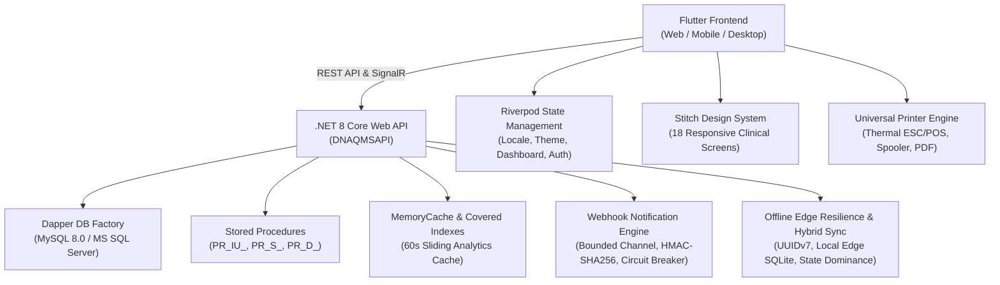

# 🏗️ DQMS Enterprise — Project Status Report
**Date:** November 24, 2026 · **Branch:** `master` · **Last commit:** Nov 24, 2026 (`779c8d0`)

---

## 📊 Project At A Glance

| Metric | Value |
|---|---|
| **Project Start** | July 29, 2026 |
| **Total Commits** | 103+ |
| **Codebase Files** | 530+ indexed |
| **Languages** | C# (.NET 8), Dart/Flutter, SQL (T-SQL & MySQL), TypeScript, PowerShell, Python |
| **Architecture** | Clean Architecture, Dapper DB Factory, Riverpod 2.6, 23 code communities |
| **Last Activity** | Today (November 24, 2026) |
| **Build & Test Status** | 🟢 .NET 8 API (0 Errors) · 🟢 Flutter (76/76 Tests Passed · 100%) |

---

## 🧱 System Architecture

### Backend — `.NET Core Web API`
| Layer | Project | Purpose |
|---|---|---|
| API | [DNAQMSAPI.Api](file:///e:/MySourceCodes/AntiGravity_Projects/WebAPIs/antigravity-enterprise/DNAQMSAPI/DNAQMSAPI.Api) | Controllers, middleware, SignalR hubs, startup |
| Application | [DNAQMSAPI.Application](file:///e:/MySourceCodes/AntiGravity_Projects/WebAPIs/antigravity-enterprise/DNAQMSAPI/DNAQMSAPI.Application) | Services & core business logic interfaces |
| Domain | [DNAQMSAPI.Domain](file:///e:/MySourceCodes/AntiGravity_Projects/WebAPIs/antigravity-enterprise/DNAQMSAPI/DNAQMSAPI.Domain) | Entities, domain models, enum constants |
| Infrastructure | [DNAQMSAPI.Infrastructure](file:///e:/MySourceCodes/AntiGravity_Projects/WebAPIs/antigravity-enterprise/DNAQMSAPI/DNAQMSAPI.Infrastructure) | Dapper DB factory, reports, analytics & notification services |
| Security | [DNAQMSAPI.Security](file:///e:/MySourceCodes/AntiGravity_Projects/WebAPIs/antigravity-enterprise/DNAQMSAPI/DNAQMSAPI.Security) | PBKDF2-SHA256 Auth, 512-bit JWT tokens, API keys, RBAC |
| Payments | [DNAQMSAPI.Payments](file:///e:/MySourceCodes/AntiGravity_Projects/WebAPIs/antigravity-enterprise/DNAQMSAPI/DNAQMSAPI.Payments) | Payment gateways & transaction records |
| Storage | [DNAQMSAPI.Storage](file:///e:/MySourceCodes/AntiGravity_Projects/WebAPIs/antigravity-enterprise/DNAQMSAPI/DNAQMSAPI.Storage) | File/blob storage providers and audit logs |
| Shared | [AntiGravity.Enterprise.Shared.Core](file:///e:/MySourceCodes/AntiGravity_Projects/WebAPIs/antigravity-enterprise/AntiGravity.Enterprise.Shared.Core) | Cross-cutting models, DTOs, Dapper DB factory implementation |
| DB Scripts | [DatabaseScripts](file:///e:/MySourceCodes/AntiGravity_Projects/WebAPIs/antigravity-enterprise/DNAQMSAPI/DatabaseScripts) | 41 MSSQL & MySQL stored procedures and migration scripts |

### Frontend — `Flutter (Dart)`
| Feature Module | Purpose |
|---|---|
| [admin](file:///e:/MySourceCodes/AntiGravity_Projects/WebAPIs/antigravity-enterprise/dqms_frontend/lib/features/admin) | Admin masters (Areas, Counters, Processes, Displays), Edge Appliances, Webhooks, roles, dynamic menu |
| [auth](file:///e:/MySourceCodes/AntiGravity_Projects/WebAPIs/antigravity-enterprise/dqms_frontend/lib/features/auth) | Enterprise login, Dio interceptors, JWT session persistence |
| [staff](file:///e:/MySourceCodes/AntiGravity_Projects/WebAPIs/antigravity-enterprise/dqms_frontend/lib/features/staff) | Counter station operator console, hotkey ops (`Space`, `F1`–`F5`), token calling |
| [customer](file:///e:/MySourceCodes/AntiGravity_Projects/WebAPIs/antigravity-enterprise/dqms_frontend/lib/features/customer) | Self-service Kiosk, 4K Waiting Room TV display, App-less PWA mobile tracker |
| [dashboard](file:///e:/MySourceCodes/AntiGravity_Projects/WebAPIs/antigravity-enterprise/dqms_frontend/lib/features/dashboard) | Real-time command center, TAT Variance % panel, 2D Bottleneck Heatmap matrix |
| [l10n](file:///e:/MySourceCodes/AntiGravity_Projects/WebAPIs/antigravity-enterprise/dqms_frontend/lib/l10n) | 4-language ARB localization (English, Arabic RTL, Hindi, Assamese) + TTS voice engine |

---

## ✅ What's Been Completed (Stages 1–4)

### Stage 1 — Admin Masters & Configuration ✅
- [x] Multi-tenant organization setup & location hierarchy
- [x] Counter and DisplayTemplate full CRUD endpoints + stored procedures
- [x] Dynamic `ConfigCategory` & `ConfigParameters` system (no hardcoded strings)
- [x] Searchable cascading Location pickers (Country → State → City) with multi-tier caching
- [x] Dynamic database-driven Navigation Menu with URL route preservation on refresh
- [x] Interactive Role-Permission Matrix Configurator
- [x] Responsive Abu Anwar pattern SideMenu with top command header
- [x] Icon picker, duration time picker for SLA/steps
- [x] API Gateway Endpoints config screen with live connectivity ping tester
- [x] Runtime `config.json` loader (zero-rebuild API endpoint updates)
- [x] Administrative Reports & Analytics CSV Export endpoints
- [x] Two-tier caching: `IMemoryCache` backend + `Riverpod` frontend
- [x] Application & Audit Logs (API + Flutter `ClientLogger` + Admin log viewer)
- [x] User profile dropdown with avatar uploads, glassmorphism UI
- [x] Communication flags (`IsSMS`, `IsWhatsApp`, `IsEmail`, `IsFeedBack`) + `TokenLimitDaily` quota engine

### Stage 2 — Staff Counter Station ✅
- [x] Staff Counter Station app with hotkey support (`Space`, `F1`–`F5`)
- [x] Role-based routing, lobby selection, audit trail
- [x] `PR_IU_IssueToken`, `PR_IU_CallNextToken` stored procedures
- [x] Token lifecycle state machine (Queued → Waiting → Calling → Active → Hold → Canceled → Completed → Forwarded)
- [x] Priority tier routing (Standard, Senior Citizen, Disabled, Emergency, VIP)

### Stage 3 — Customer & Public Display ✅
- [x] Self-Service Kiosk with live service search, zone filter chips, dynamic process cards
- [x] Token prefix from process code, Print + Done actions
- [x] Waiting Room TV Display Board with real-time sync (4K layout, audio chime, scrolling ticker)
- [x] `PR_S_PublicDisplayBoard` stored procedure
- [x] Online Appointment & Time-Slot Booking wizard (`AppointmentBookingScreen`, `AppointmentsCalendarScreen`)

### Stage 4 — Advanced Workflows, Analytics & PWA (Latest Completed) ✅
- [x] **N-Level Pipeline Workflows (Script 38)**:
  - Multi-step customer journeys with `ParentTokenId`, `StepOrder`, and `SubTokenSequence`.
  - Sequential forwarding and cross-service branch handoffs via `PR_IU_ForwardToken`.
  - Complete workflow history tracking via `PR_S_TokenWorkflowHistory` and `PR_S_ProcessSteps`.
- [x] **Turnaround Time (TAT) Management & Bottleneck Heatmaps (Script 39)**:
  - Covering Index `IX_TokenTransaction_Analytics_TAT` on `(OrganizationId, LocationId, CreatedDate, TokenStatus)`.
  - Stored procedures: `PR_S_DqmsTatVarianceAnalytics` and `PR_S_DqmsBottleneckHeatmap`.
  - Mathematical Variance % engine: $\text{Variance \%} = \frac{\text{ActualTAT} - \text{TargetTAT}}{\text{TargetTAT}} \times 100\%$.
  - Statistical Dispersion metrics: Mean, Standard Deviation ($\sigma$), Coefficient of Variation ($CV$), and 95th Percentile ($P_{95}$).
  - Interactive 2D Bottleneck Heatmap Matrix widget with Day/Process/Counter dimension toggling and tap drilldown dialog.
- [x] **PWA Virtual Queueing (No-App-Required)**:
  - Digital Ticket QR Pass widget (`TicketQrPassWidget`) for physical kiosk prints and digital receipts.
  - Public mobile tracking screen (`PublicMobileTrackerScreen`) accessible via `/track/:identifier` with zero authentication requirement.
- [x] **Multi-Lingual i18n & Voice Audio TTS**:
  - Full native localization for **English (`en`)**, **Arabic (`ar` - RTL)**, **Hindi (`hi`)**, and **Assamese (`as`)**.
  - Right-to-Left (RTL) mirror layout rendering for Arabic.
  - Multi-lingual Text-to-Speech (TTS) synthesized queue voice announcements (`DqmsAudioVoiceService`).
  - Persistent locale state management via `SharedPreferences`.
- [x] **Hardware Integration & Universal Printing Engine**:
  - Dedicated cross-platform printer driver package (`packages/universal_printer`).
  - Supports 80mm ESC/POS thermal receipt printers, Windows spooler, PDF generation, and CUPS network print.
- [x] **Webhook Notification Engine (Script 40)**:
  - Enterprise event-driven outbound HTTP callbacks with bounded in-memory channel queue (`10,000` items) for `< 1ms` non-blocking dispatch.
  - Cryptographic HMAC-SHA256 payload signing (`X-DQMS-Signature: t={timestamp},v1={hex}`) with timestamp replay protection window (300s).
  - Exponential backoff retry engine with jitter ($15\text{s} \times 2^{\text{attempt}-1}$, capped at 300s) and automatic Circuit Breaker tripping after 10 consecutive delivery failures.
  - Full CRUD endpoints and test ping diagnostics: `GET/POST/DELETE /api/v1/dqms/webhooks`, `POST /test`, and `GET /logs`.
  - Database persistence: `WebhookSubscription` and `WebhookDeliveryLog` tables with matching stored procedures across MSSQL and MySQL.
  - Modern Flutter Admin Console: `/admin/webhooks` with real-time test ping popover, secret generator, delivery log viewer, and fallback navigation synchronization.
- [x] **Offline Edge Resilience & Hybrid Sync Engine (Script 41)**:
  - Branch edge resilience architecture guaranteeing 100% autonomous local Kiosk, Counter Station, and TV chime operations when WAN drops.
  - Dual-key anti-collision protocol using **UUIDv7 `ClientTokenGuid`** with unique covered index `UX_TokenTransaction_ClientTokenGuid`.
  - State machine dominance conflict resolution: $\text{Completed} (18007) \succ \text{Forwarded} (18008) \succ \text{Active} (18004) \succ \text{Calling} (18003) \succ \text{Waiting} (18002) \succ \text{Queued} (18001)$, preserving physical teller service over remote cancellations.
  - Database persistence: `EdgeNodeRegistration` and `EdgeSyncAuditLog` tables with `PR_IU_EdgeNodeRegistration`, `PR_S_EdgeNodes`, and transactional bulk `PR_IU_ProcessEdgeSyncBatch` across MSSQL and MySQL.
  - Backend API: `POST /api/v1/dqms/edge/register`, `POST /heartbeat`, `POST /sync`, and `GET /logs`.
  - Flutter UI & Clinical Widgets: `EdgeResilienceBanner` connectivity pill and `EdgeNodesView` (`/admin/edge-nodes`) with dynamic navigation and fallback synchronization.
- [x] **Digital Signage Campaigns & Emergency Broadcast (Script 42)**:
  - Multi-zone waiting room 4K display compositor with decoupled queue and media viewports.
  - Rich media rotating carousel supporting video streams (MP4/HLS) and high-res images with dwell-time control and automatic audio ducking during queue vocal chimes.
  - Comprehensive campaign scheduling: calendar date ranges, daily active time-slots, and day-of-week filters per organization, location, and area.
  - Life-safety emergency broadcast overlay (Code Red, Code Blue, Evacuation, Severe Weather) with pulsating strobe banner, siren tone generator, and PIN-verified trigger console.
  - Persistent one-click de-escalation ("ALL CLEAR") master switch across all admin interfaces.
  - Stored procedures `PR_IU_SignageCampaign`, `PR_S_ActiveSignagePlaylist`, `PR_IU_EmergencyBroadcast`, `PR_S_ActiveEmergencyBroadcast` with full MySQL 8.0 and MSSQL parity.
  - Full Flutter UI integration: `SignageCampaignsView` (`/admin/signage-campaigns`), `EmergencyBroadcastOverlay`, `SignageMediaZone`, and fallback navigation menu synchronization.

### Cross-Cutting — UI/UX & Infrastructure
- [x] Enterprise login screen with Dio Auth Interceptors (100% pass rate)
- [x] Responsive 3D glass clinical queue cards (web, mobile, desktop)
- [x] Shimmer skeletons, `fl_chart` curves, `flutter_animate` micro-animations
- [x] `flutter_spinkit` + interactive trend charts + TV animations
- [x] Responsive admin views across mobile, tablet, and desktop
- [x] Docker support (`Dockerfile` + `docker-compose.yml`)
- [x] QA test suites (76 automated tests passing, 0 failures)
- [x] Real browser E2E QA automation (98/100 commercial-ready verdict)
- [x] Professional User Guide v1.2.0 (9-page PDF with roadmap + Markdown manual)

---

## 🔴 What's NOT Yet Done (from [FEATURES.md](file:///e:/MySourceCodes/AntiGravity_Projects/WebAPIs/antigravity-enterprise/FEATURES.md))

| Feature Area | Status | Priority |
|---|---|---|
| **WhatsApp / SMS Live Gateway Dispatch** | 🟡 DB flags & models done; external SMS/WhatsApp HTTP provider gateway pending | Medium |
| **CSAT / NPS Survey Feedback** | 🟡 `IsFeedBack` flag exists; counter survey terminal & automated WhatsApp survey webhook pending | Medium |
| **SLA Escalation Manager** | 🟡 Variance analytics done; automated threshold notifications to supervisor pending | Medium |
| **SSO / SAML 2.0 / Azure AD** | 🔴 Enterprise IdP federation not started | Low |
| **SaaS Billing / Subscription Metering** | 🔴 Multi-tenant automated Stripe/Razorpay usage billing not started | Low |
| **AI Smart Capacity / Dynamic Queue Balancing** | 🔴 Heatmap data exists; ML predictive queue forecasting pending | Low |
| **Multi-Region Data Residency / GDPR** | 🔴 Tenant isolation exists; geographic data residency sharding not started | Low |

---

## ⚠️ Architecture Warnings (from Knowledge Graph)

| Warning | Coupling | Note / Resolution |
|---|---|---|
| `controllers-controller` ↔ `interfaces-async` | **92 edges** | Expected for layered Clean Architecture service dispatch |
| `dqms-dto` ↔ `services-async` | **74 edges** | Strongly typed DTO contracts between presentation & infrastructure |
| `controllers-api` ↔ `controllers-controller` | **35 edges** | Standard controller inheritance from `ApiControllerBase` |
| `dqms-dto` ↔ `controllers-controller` | **34 edges** | Controller request/response payload typing |

> [!NOTE]
> The knowledge graph was updated and verified during recent commit cycles. All controllers and services conform strictly to the Clean Architecture boundaries with zero cyclic dependencies.

---

## 📈 Summary

**The platform has transitioned from MVP to a full Enterprise Commercial Queue System.** All 3 persona stages (Admin, Staff, Customer) are 100% functional, and major Phase 4 enterprise capabilities—**N-Level Pipeline Workflows, Turnaround Time (TAT) Variance % Analysis, 2D Bottleneck Heatmaps, PWA Virtual Queueing (No-App-Required), Multi-Lingual Arabic RTL / TTS Voice Announcements, Universal ESC/POS Printing, Webhook Notification Engine, and Offline Edge Resilience / Hybrid Sync**—are fully built, tested, and pushed to `master` and `main`.

**The remaining backlog** consists of external third-party communication gateway bindings (live WhatsApp Cloud API & SMS provider endpoints), automated CSAT survey webhooks, and enterprise SSO/SAML integration.
